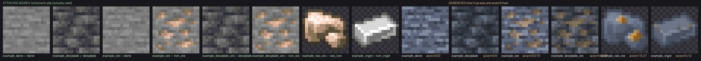

# dsh-mc-art-panel

给 DSH 用的 Minecraft 模组工作台。装一个包，面板、模式、两个 skill 都在里面。



## 装

```bash
dsh plugin --profile desktop add dsh-mc-art-panel
```

`desktop` 是桌面端的 profile 名，命令行起的 web 实例一般叫 `web`。装完彻底退出 DSH 再打开
（托盘里关窗口不算），右侧栏会多出「MC 资产」，模式名单里会多一个「MC 模组工作室」。

国内拉包慢就加 `--registry=https://registry.npmmirror.com/`。不想走 npm 也行，Release 里有一份
不带版本号的 tarball，地址一直有效：
`https://github.com/GMH13552/dsh-mc-art/releases/latest/download/dsh-mc-art-panel.tgz`

## 装上之后

在「MC 资产」里选一个模组工程，就能看见资产实际长什么样：方块可以转着看，物品排成游戏里那排九格。

看着不对就直接改。像素编辑器有铅笔、油漆桶、取色和橡皮，方块能按面改，结构能一格一格摆。
保存只写你项目里的资源包，不碰 jar，也不写会话日志。

想听意见就点「@ 提意见」，它把这件资产的引用放进输入框，你补一句话发出去就行。

改完交给游戏判断。跑一次 GameTestServer，退出码就是没通过的测试数。

## 包里有什么

```
lib/          面板本体（宿主半边 + 客户端半边）
preset/       「MC 模组工作室」模式，以及随它走的 mc-mod、mc-art 两个 skill
```

美术引擎 `mc-art` 在另一个仓库（[GMH13552/mc-art](https://github.com/GMH13552/mc-art)），
这里是发布时的快照。想跟最新就 clone 那个仓库，或者跑一遍本仓库的 `install.mjs`。

## 几件容易踩的事

- 升级完要重启进程。后台那一半是启动时装配的，只换磁盘上的文件会出现“界面是新的、后台还是旧的”，
  症状是面板报「宿主没有这个方法」。
- 它不替你判断美丑。选哪张参考、什么东西该像、起什么名字，是你的判断；量像素、扫 jar、读退出码，
  是脚本的事。你写下为什么这么选，脚本留下它量到的数。
- 它只写你项目里的资源包。不写游戏安装目录，不写 jar。

完整说明、门禁清单和踩过的坑都在
[github.com/GMH13552/dsh-mc-art](https://github.com/GMH13552/dsh-mc-art)。
有问题去那边开 issue，把面板上的报错原样贴进来就行。

MIT。
